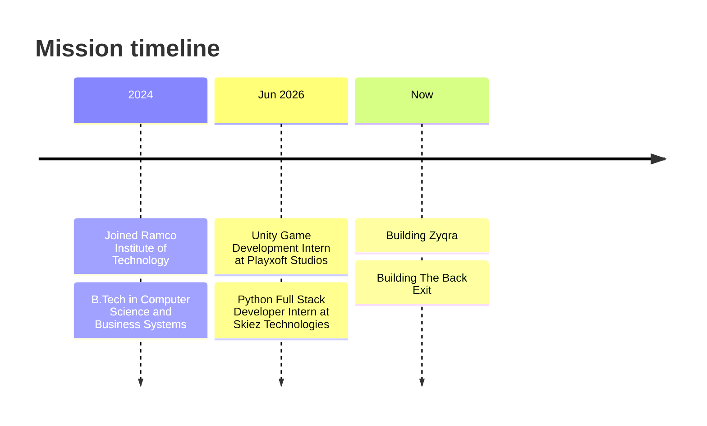

<div align="center">

<a href="https://sgokulakumaran.github.io/face/" title="Open VOYAGER // FACET 01 — interactive 4-mode 3D face">
  
</a>

<sub>This portrait is typeset from my own name and code symbols. Click it to open <b>VOYAGER // FACET 01</b> — the interactive 4-mode 3D field.</sub>

<br><br>

[](https://gokulakumarans.pages.dev)
[](https://www.linkedin.com/in/gokula-kumaran-s-503545328/)
[](mailto:gokulakumaran2007@gmail.com)
[](https://ride-wise.pages.dev)

</div>

I build game worlds in Unity and products on the web. Most of my projects start as one idea and end as something you can open, play or use.

I'm a second-year B.Tech Computer Science and Business Systems student at Ramco Institute of Technology, which means I think about both the engineering and the product.

```csharp
public class Gokulakumarans : Developer
{
    public string[] Builds   = { "Game worlds", "Full-stack apps", "AI study tools" };
    public string   Engine   = "Unity HDRP";
    public string[] Training = { "Cricket", "Ball badminton", "Chess" };
    public string   Status   = "Open to work";
    void Update() => Ship(Idea.Next());
}
```

## Skill system

<div align="center">
  
</div>

<div align="center">


</div>

## Quest log

Tap a quest to open it.

<details open>
<summary><b>RideWise</b> · navigation and vehicle tracking · <a href="https://ride-wise.pages.dev">live app</a></summary>
<br>

A navigation platform for solo and group rides.

- Solo rides with start-to-destination route mapping.
- Group rides with invitations, shared maps and live rider-location tracking.
- Vehicle tracking for college buses and organizational fleets.

[Live app](https://ride-wise.pages.dev) · [Watch the demo](https://drive.google.com/file/d/1E6lUD8i4y4ZnQ73IWQIi5h3QJdVsaJIH/view?usp=sharing)

</details>

<details>
<summary><b>Zyqra</b> · AI-powered learning app · <i>full version in development</i></summary>
<br>

A study platform for real-time doubt solving, automatic quiz generation and flashcard conversion, plus a focus timer and a performance dashboard built with Python and Streamlit.

[Watch the demo](https://drive.google.com/file/d/1h8Yg5gZb3Wj7oQy8TUWKOn0tPcxKSOrQ/view?usp=sharing)

</details>

<details>
<summary><b>The Back Exit</b> · first-person horror game · <i>full version in development</i></summary>
<br>

A Unity horror game with camera bobbing, trigger-based jump scares and AI-driven NPC pathfinding, plus vehicle control and interactive driving sequences.

[Watch the demo](https://drive.google.com/file/d/1x6Pqo-LCrpF1eI71ZA0mjE6xw53rBKLH/view?usp=sharing)

</details>

<details>
<summary><b>Realistic Forest</b> · Unity HDRP environment</summary>
<br>

A high-fidelity forest with detailed terrain and texturing, procedural foliage placement, and performance tuning so it runs smoothly.

[Watch the demo](https://drive.google.com/file/d/1hseqUxI7Is2xNDhZsYQF41vo1Ki_Thh2/view?usp=sharing)

</details>

<details>
<summary><b>Procedural Terrain</b> · Unity and C#</summary>
<br>

A terrain system built on Perlin noise and procedural mesh generation, with octaves, seed-based generation and terrain chunks for dynamic landscapes.

[Watch the demo](https://drive.google.com/file/d/1ANXxPx5xwAo3oZAbDvCilACGcx5ArFCo/view?usp=drive_link)

</details>

## Flight log



<details>
<summary><b>Internship details</b></summary>
<br>

**Playxoft Studios** · Unity Game Development Intern · Remote, June 2026
Worked on procedural landscape generation with Unity and C#, and helped with debugging, testing and performance optimization. [Certificate](https://drive.google.com/file/d/1kctzEqwXPVOWvU2A2ORoARd3gaBNHvXX/view?usp=drive_link)

**Skiez Technologies** · Python Full Stack Developer Intern · Onsite, June to July 2026
Built practical full-stack projects across frontend and backend with Python and modern web technologies. [Certificate](https://drive.google.com/file/d/1caz4L7BK6R6RH03b7qcw-ktyJjnLVAW0/view?usp=drive_link)

</details>

## Achievements unlocked

| | Achievement |
|---|---|
| 🏏 | District-level cricket player for Virudhunagar, **3rd place in the CM Trophy** |
| 🏸 | **District 1st place** in ball badminton |
| ♟️ | **Inter-college chess champion** |
| 💻 | 24-hour hackathon at KPR Institute of Engineering, where I built an AI study app for biotechnology students |
| 🤝 | Internal hackathon at Ramco Institute of Technology |

## Telemetry

<div align="center">



<br><br>

<picture>
  <source media="(prefers-color-scheme: dark)" srcset="https://raw.githubusercontent.com/sGokulaKumaran/sGokulaKumaran/output/github-snake-dark.svg">
  <source media="(prefers-color-scheme: light)" srcset="https://raw.githubusercontent.com/sGokulaKumaran/sGokulaKumaran/output/github-snake.svg">
  
</picture>

</div>

## Open channel

I'm open to internships, freelance projects and game-dev collaborations. The fastest way to reach me is [email](mailto:gokulakumaran2007@gmail.com). You can also find me on [LinkedIn](https://www.linkedin.com/in/gokula-kumaran-s-503545328/) or fly through my [portfolio](https://gokulakumarans.pages.dev).

<div align="center">
<sub>Voyager OS 01 · every glyph in the portrait above spells part of my name</sub>
</div>
